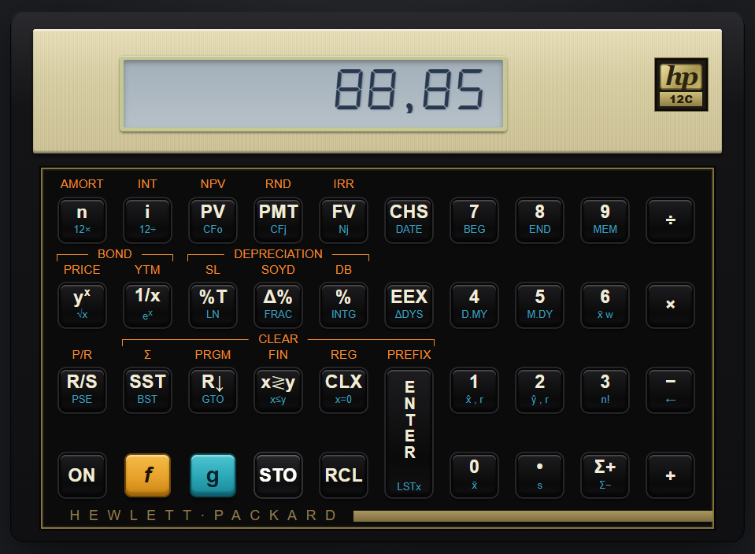

# Calculadora 12C

Réplica de estudo da calculadora financeira HP 12C para Windows (Electron). Funciona offline e guarda o estado entre uso (memória contínua).



## Recursos
- Pilha RPN de 4 níveis, LSTx, porcentagens, √x, eˣ, LN, n!, FRAC/INTG, RND
- Financeiro: n, i, PV, PMT, FV (BEGIN/END, juros simples ou compostos na fração do período), 12× e 12÷
- Fluxos de caixa com NPV e IRR (CFo, CFj, Nj)
- AMORT, INT, depreciação (SL, SOYD, DB), títulos (PRICE, YTM)
- Datas (DATE, ΔDYS, D.MY/M.DY), estatística (Σ+, x̄, s, regressão linear, média ponderada)
- **Programação de até 99 linhas**: gravação por códigos de tecla, GTO, testes x≤y e x=0, R/S, SST/BST, PSE, memória compartilhada com os registradores
- Teclado do computador, copiar/colar números, exportar/importar programas, separador decimal à escolha
- Guia completo no próprio app (**F1**) e tela de atalhos do teclado com mini-teclado (**F2** ou **?**)

## Baixar
Na página de [Releases](../../releases) há o instalador e a versão portátil (sem instalar). O Windows pode avisar "aplicativo não reconhecido" porque o programa não tem assinatura digital: use "Mais informações" → "Executar assim mesmo".

## Desenvolver
```bash
npm install
npm start                                 # abre o app
npm test                                  # testes do motor (src/engine.js)
npm run dist                              # gera instalador e portátil em dist/
npx electron scripts/smoke.js <pasta>     # abre o app, aperta teclas e salva capturas
npx electron scripts/make-icon.js         # regenera build/icon.png
```

### Estrutura
- `src/engine.js`: motor da calculadora, sem DOM (roda no Node e no navegador)
- `src/ui.js`, `src/style.css`, `src/index.html`: tela e teclado
- `main.js`, `preload.js`: janela, menu, configurações, importar/exportar programa
- `test/engine.test.js`: testes com resultados conhecidos da 12C

## Fidelidade
Os resultados seguem as convenções documentadas da HP 12C, mas o projeto foi feito sem uma calculadora física para comparação. Alguns detalhes podem diferir do aparelho real: a ordem de certos resultados na pilha (PRICE, INT), o número de casas da notação científica e os códigos de algumas mensagens de erro. Correções com exemplos do aparelho real são muito bem-vindas (abra uma issue).

## Aviso legal
Projeto independente e educacional, **sem vínculo, patrocínio ou endosso da Hewlett-Packard / HP Inc.** "HP" e "HP 12C" são marcas de seus respectivos titulares. A aparência do aparelho é reproduzida apenas como referência visual de estudo; se você for redistribuir o app, considere trocar o logotipo e o texto da faixa inferior.

## Licença
[MIT](LICENSE). A fonte do visor (DSEG7) usa a SIL Open Font License 1.1 (`src/fonts/DSEG-LICENSE.txt`).
